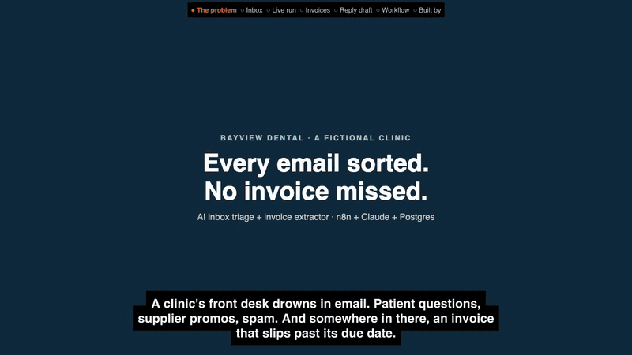

# AI Inbox Triage + Invoice Extractor (n8n + Claude)

An inbox assistant for a dental clinic's front desk. Every minute it reads new email, has Claude sort each one (invoice, patient enquiry, supplier, spam), copies supplier invoice details into one table, flags overdue and due-soon bills as urgent, and drafts replies to patient questions for staff to check and send.
The front desk sees the sorted inbox, the invoices with the total due, and the drafts on one dashboard.

**What this proves:** an n8n workflow that reads a mailbox every minute, has Claude sort each email, keeps an invoice only when its vendor and number really appear in the email, flags overdue bills, drafts replies for staff, and never processes the same email twice. `./check.sh` asserts each of those end to end.

[](demo/p3-demo.mp4)

12-second preview at 5x speed. Click it for the full 83-second narrated demo (`demo/p3-demo.mp4`).

**Live case study:** https://mckenneth.vercel.app/case-studies/inbox-triage/

**Checks**, run on 16 Oct 2026 (`parse.check.mjs` needs no services; `check.sh` ran against the Docker stack below with live Claude calls; real output):

```text
$ node parse.check.mjs
parse ok: 8 cases
$ ./check.sh
sent 8 emails to frontdesk@bayviewdental.example
run 1: {"processed":8,"invoices":3,"drafts":3,"high":3}
p3 ok: 8 emails
p3 ok: invoices 3500.00,6200.00,18450.00
p3 ok: 3 drafts
p3 ok: spam
p3 ok: overdue CleanPro is high
run 2: {"processed":0,"invoices":0,"drafts":0,"high":0}
p3 ok: idempotent
```

**Caveat:** demo for a fictional clinic (Bayview Dental), not client work. Vendors, patients and invoices are made up, and it reads a local test mailbox (Mailpit), not a real inbox. Nothing is sent: drafts wait for a person.

## Architecture

The n8n workflow (`workflow.json`):

```
Every minute (Schedule)  or  Run now (Webhook POST /webhook/inbox-run)
  -> List messages  HTTP Request: Mailpit /api/v1/messages
  -> Known ids      Postgres: which of these are already in p3_emails
  -> Filter new     Code: keep only new emails (Any new? -> else "Nothing new")
  -> Each email     Split in Batches, one at a time
  -> Get message    HTTP Request: Mailpit /api/v1/message/{ID}
  -> Load kb        Postgres: the clinic info sheet
  -> Build prompt   Code: info sheet + today + email -> one prompt
  -> Ask Claude     HTTP Request -> bridge.mjs /reply -> Claude (returns JSON: category, urgency, summary, invoice, reply_draft)
  -> Parse          Code (parse.js): strict JSON, whitelisted values; an invoice is kept only if the vendor
                    and invoice number appear in the email and the date is real, else supplier/high for a person
  -> Save           Postgres: email row, invoice row, reply draft (all as $n parameters, on conflict do nothing)
  -> Summary/Respond  { processed, invoices, drafts, high }
```

| File | What it is |
| --- | --- |
| `workflow.json` | the n8n workflow |
| `parse.js`, `parse.check.mjs` | the Parse node's code and its check (asserts it matches the code inside `workflow.json`) |
| `schema.sql` | tables (`p3_emails`, `p3_invoices`, `p3_drafts`, `kb`) |
| `knowledge.md` | the clinic info sheet the reply drafts answer from |
| `samples.json`, `send-samples.mjs` | 8 fictional emails, sent over plain SMTP to the Mailpit test mailbox (due dates relative to today) |
| `pg-credential.json` | n8n Postgres credential (local demo login `va`/`va`) |
| `dashboard.html` | the front-desk dashboard (served by the bridge at `/`, reads `/p3/state`) |
| `bridge.mjs` | tiny local server: `/reply` calls the `claude` CLI, also serves the dashboard |
| `check.sh`, `check-bridge.sh` | end-to-end checks |
| `demo/` | scripts that recorded the demo video (Playwright capture, narration, ffmpeg assembly) and `p3-demo.mp4` |
| `case-study.html` | the case study page |

## How to run

Needs Docker, Node 18+, and the [Claude Code](https://claude.com/claude-code) CLI (`claude`) logged in.

```bash
cp .env.example .env            # set N8N_ENCRYPTION_KEY
docker compose up -d             # n8n :5678, Postgres, Mailpit :8025 (web UI) / :1025 (SMTP)
docker exec -i va-pg psql -U va -d va < schema.sql
echo "insert into kb(id,body) values (1, :'kb') on conflict (id) do update set body=excluded.body;" \
  | docker exec -i va-pg psql -U va -d va -v kb="$(cat knowledge.md)"

docker exec n8n n8n import:credentials --input=/demo/pg-credential.json
docker exec n8n n8n import:workflow --input=/demo/workflow.json
docker exec n8n n8n publish:workflow --id=vaP3InboxTriage
docker restart n8n               # pick up the published workflow

node bridge.mjs                  # :8788, keep it running
./check-bridge.sh                # bridge ok, state ok
```

Send the sample emails and watch them get sorted:

```bash
node send-samples.mjs --clear    # empties the test mailbox, sends the 8 samples
```

Open http://localhost:8025 (the test mailbox) and http://localhost:8788/ (the dashboard). The schedule picks the emails up within a minute, or trigger it now with `curl -X POST localhost:5678/webhook/inbox-run`. Or run the end-to-end check:

```bash
./check.sh                       # 8 emails sorted, 3 invoices (3500, 6200, 18450), drafts, spam caught, overdue = high, 2nd run processes 0
node parse.check.mjs             # the Parse rules, no services needed
```

The n8n editor is at http://localhost:5678 (create the owner account on first open).

## Using a real inbox

This demo reads a local test mailbox (Mailpit) so no real inbox is touched. To use Gmail or Outlook, replace the "List messages" and "Get message" nodes with n8n's Gmail or Microsoft Outlook node (OAuth credential to your account) and map the sender, subject and body into "Build prompt"; the sort, parse and save steps stay the same. That swap has not been run against a real inbox here.

## Honest notes

- This is a demo for a fictional clinic, Bayview Dental. The vendors, patients, invoices and prices are made up; all addresses are `example.com` / `.example`.
- Claude is called through `bridge.mjs`, a small local bridge to the `claude` CLI, so the demo runs on a Claude subscription without an API key. In production, swap the "Ask Claude" node for n8n's Anthropic (or OpenAI) node with an API key and drop the bridge.
- Nothing is sent: reply drafts are saved for a person to check and send.
- The Postgres login `va`/`va` is a local demo credential, only reachable inside Docker. Mailpit is bound to 127.0.0.1.
- Re-recording the video: `demo/capture.mjs` needs Playwright (`npm i playwright` or set `PW=/path/to/playwright`), and `demo/say-clone.py` needs your own voice clip via `REF=/path/to/clip.wav` (never committed).

Built by McKeen Asma with Claude Code. MIT licence.
